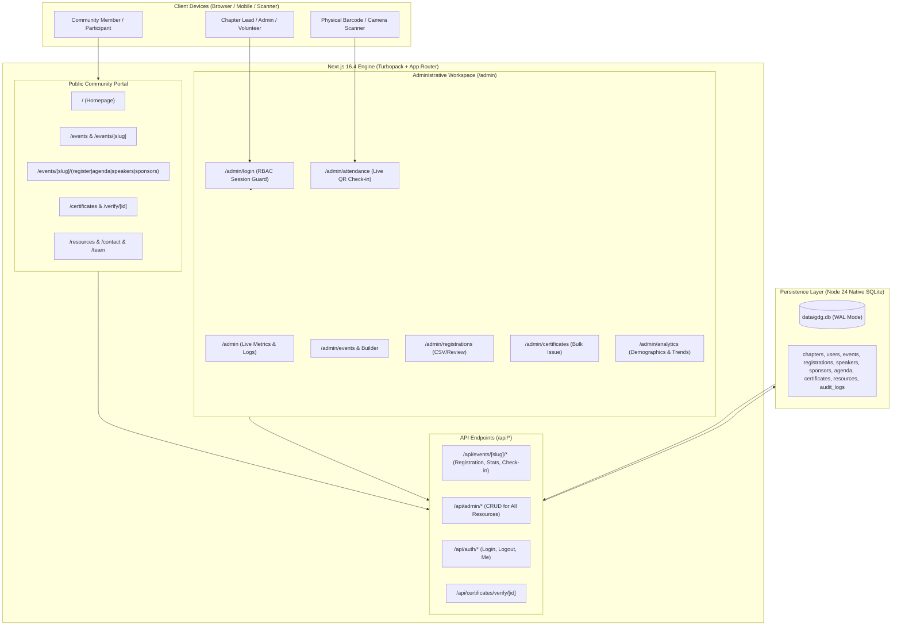

# GDG VCET Platform — System Architecture

## 1. Executive Summary & Vision

The GDG VCET Platform is a centralized, high-performance developer community operating system built for Google Developer Groups on Campus at Vidyavardhini's College of Engineering and Technology (VCET), Vasai. 

Rather than maintaining disjointed tools (Google Forms for registration, Google Sheets for tracking, separate landing pages, manual certificate generators, and static site updates), the platform consolidates all community operations into a **unified monolith** combining:
1. **A public-facing developer community portal** with dynamic event discovery, Stitch-designed workshop microsites, resources, team profiles, contact channels, and verifiable credentials.
2. **An administrative control center (`/admin`)** providing complete lifecycle control over events, attendees, QR check-in, agenda, speakers, sponsors, team RBAC, announcements, certificates, and real-time database analytics.

---

## 2. Core Architectural Principles

- **Zero-Dependency Native Persistence:** Powered by Node 24's native `node:sqlite` (`DatabaseSync`) operating in Write-Ahead Logging (WAL) mode. Zero cloud database configuration or external Docker containers are required for development or self-hosted deployment.
- **Strict Real-Data Determinism:** All analytics, event counters, registration rosters, and check-in tallies derive from direct SQLite SQL aggregations. There are no fabricated numbers, simulated animation timers, or artificial increments.
- **Dual-Application Boundary within One Monolith:**
  - Public routes (`/`, `/events`, `/about`, `/team`, `/resources`, `/certificates`, `/contact`) are optimized for fast static generation, partial prerendering, and SEO.
  - Admin routes (`/admin/*`) share a persistent sidebar workspace shell (`AdminLayoutShell`), enforcing role-based permissions, real-time filters, and operational tooling.
- **Stitch Design System Integration:** Preserves and scales the clean visual aesthetic of the Google Developer brand (`#1A73E8` Blue, `#006E2C` Green, `#FBBC04` Yellow, `#B51B15` Red) with container-based surface tiers (`bg-surface`, `bg-surface-container`, `border-border`).
- **Multi-Tenant Foundation with Single-Tenant Focus:** All core database entities possess a `chapter_id` foreign key. While initially scoped to `gdg-vcet`, the data layer supports multi-chapter partitioning without architectural rework.

---

## 3. System Topology & Request Lifecycle



---

## 4. Layer Architecture & Boundary Contracts

### 4.1 Presentation Layer (App Router)
- **Framework:** Next.js 16.4.3 with Turbopack, React 19, and Tailwind CSS 4.
- **Route Segregation:**
  - `src/app/(public)`: Dynamic server and static components with partial prerendering (`generateStaticParams` for known slugs to ensure instantaneous initial load).
  - `src/app/admin`: Client-rendered interactive dashboards backed by server components delivering initial dehydrated SQLite state.
- **Component Design System:**
  - `src/components/workshop/*`: Stitch-derived multi-page workshop experience (`EventDetailsView`, `EventRegisterView`, `EventAgendaView`, `EventSpeakersView`, `EventSponsorsView`).
  - `src/components/admin/*`: High-density administrative views (`CentralRegistrationsView`, `AttendanceHubView`, `EventBuilderForm`, `PlatformAnalyticsView`, `CertificatesManagerView`, etc.).
  - `src/components/public/*`: Public catalog components (`ResourcesView`, `ContactView`, `VerifiedCertificateCard`, `CertificateLookupView`).

### 4.2 Application / Business Logic Layer
- **Registration Engine (`src/lib/events.ts`):** Enforces event capacity limits, checks registration deadlines, verifies duplicate emails, determines waitlist thresholds, and issues formatted reference codes (`GDG-VCET-2025-XXXX`).
- **Authentication & RBAC (`src/lib/auth/index.ts` & `src/lib/auth/roles.ts`):**
  - High-entropy scrypt password hashing with unique per-user salts.
  - Session tokens generated via `crypto.randomBytes(32)` stored in HttpOnly, SameSite cookies.
  - Client-safe role permission evaluator (`hasPermission(role, permission)`).
- **Attendance Verification (`src/lib/events.ts`):** Double-check-in prevention, atomic timestamp recording, and pass reference resolution.
- **Bulk Certificate Issuance (`src/lib/db/index.ts`):** Automates credential creation for verified attendees with unique certificate serial numbers (`CERT-VCET-2025-XXXX`).

### 4.3 Persistence Layer (`src/lib/db/index.ts`)
- **Engine:** `node:sqlite` (`DatabaseSync`), native in Node.js >= 22.
- **Concurrency & Integrity:**
  - SQLite Write-Ahead Logging (`PRAGMA journal_mode = WAL;`) allows concurrent readers while writes execute safely.
  - Foreign key constraints enabled (`PRAGMA foreign_keys = ON;`).
  - Busy timeout configured to 5000ms (`PRAGMA busy_timeout = 5000;`) to eliminate lock contention during concurrent API traffic.
- **Serialization Isolation:**
  - Node 24 native SQLite returns rows with null prototypes (`[Object: null prototype]`). To prevent React 19 Server Component boundary serialization errors, all rows crossing into Client Components are cleanly sanitized into plain JavaScript objects (`{ ...row }`).

---

## 5. Security Architecture

1. **Authentication & Session Tokens:**
   - Stateless database sessions stored in `sessions` table, queried by secure cryptographic cookie.
   - 7-day expiration with automated cleanup.
2. **Access Control Matrix (RBAC):**
   - 8 granular roles strictly restrict administrative mutations (e.g., `check_in_volunteer` can only read event rosters and execute check-ins; `viewer` has read-only access).
3. **Audit Trail Logging:**
   - Sensitive administrative operations (approving payments, issuing certificates, updating chapter settings, editing registrations) trigger an append-only entry in `audit_logs` capturing actor, action, target entity, timestamp, and metadata.
4. **Credential Tamper Prevention:**
   - Public certificates reference canonical database records via non-guessable identifiers. If an attendee certificate ID is altered or revoked, the public verification route (`/certificates/verify/[id]`) marks it as invalid immediately.

---

## 6. Directory Structure Overview

```
gdg/
├── data/
│   └── gdg.db                      # Native SQLite Database (WAL Mode)
├── docs/                           # Architecture, DB Schema & API documentation
├── public/                         # Static icons, logos, photos
├── src/
│   ├── app/                        # Next.js App Router (Public & Admin)
│   │   ├── (public)/               # Public website routes
│   │   ├── admin/                  # Centralized Admin Workspace (13 modules)
│   │   └── api/                    # RESTful endpoints (Public, Admin, Auth)
│   ├── components/                 # Reusable UI components
│   │   ├── admin/                  # Admin workspace components
│   │   ├── public/                 # Public portal views
│   │   ├── ui/                     # Primitives (Badges, Buttons, Cards)
│   │   └── workshop/               # Stitch-generated workshop views
│   ├── content/                    # Seed metadata, chapters, mock configs
│   ├── hooks/                      # Custom React hooks (useLocalStorage, etc.)
│   └── lib/                        # Core engines
│       ├── auth/                   # Authentication & RBAC permissions
│       ├── db/                     # SQLite schema, migrations, queries
│       └── events.ts               # Registration & event service
└── vitest.config.ts                # Test runner configuration (fileParallelism: false)
```

