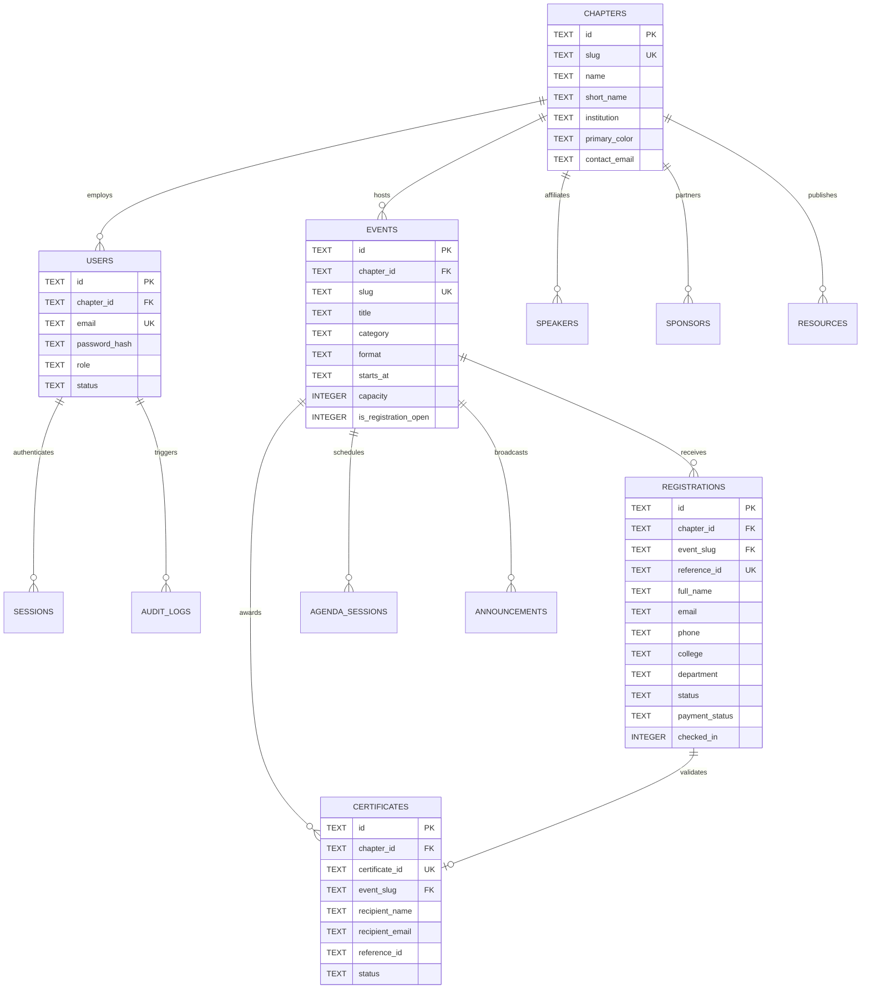

# GDG VCET Platform — Database Schema & Data Dictionary

## 1. Storage Engine Overview

- **Engine:** Node.js 24 Native Embedded SQLite (`node:sqlite.DatabaseSync`).
- **File Location:** `./data/gdg.db`
- **Concurrency Mode:** Write-Ahead Logging (`PRAGMA journal_mode = WAL;`)
- **Busy Timeout:** 5000ms (`PRAGMA busy_timeout = 5000;`) to safely handle high-frequency write concurrency without SQLITE_BUSY locks.
- **Relational Integrity:** Foreign Key enforcement enabled (`PRAGMA foreign_keys = ON;`).

---

## 2. Entity-Relationship Diagram



---

## 3. Data Dictionary

### 3.1 `chapters`
Multi-tenant organizational profiles.
| Column | Type | Constraints | Description |
|---|---|---|---|
| `id` | TEXT | PRIMARY KEY | Unique chapter identifier (e.g., `gdg-vcet`) |
| `slug` | TEXT | UNIQUE, NOT NULL | URL-safe slug |
| `name` | TEXT | NOT NULL | Full chapter name (`GDG on Campus VCET`) |
| `short_name` | TEXT | NOT NULL | Abbreviated name (`GDG VCET`) |
| `tagline` | TEXT | | Promotional punchline |
| `description` | TEXT | | Chapter history, campus context, and mission |
| `institution` | TEXT | NOT NULL | Host university/college (`Vidyavardhini's College of Engineering and Technology`) |
| `logo_url` | TEXT | | Path or URL to official chapter crest |
| `primary_color` | TEXT | DEFAULT '#1A73E8' | Hex branding color |
| `contact_email` | TEXT | | Chapter administrative contact email |
| `created_at` | TEXT | DEFAULT CURRENT_TIMESTAMP | ISO-8601 creation timestamp |

---

### 3.2 `users`
Administrative staff and organizer accounts with role-based permissions.
| Column | Type | Constraints | Description |
|---|---|---|---|
| `id` | TEXT | PRIMARY KEY | User identifier (e.g., `usr-admin-vcet`) |
| `chapter_id` | TEXT | FK (`chapters.id`) | Tenant boundary |
| `name` | TEXT | NOT NULL | Organizer full name |
| `email` | TEXT | UNIQUE, NOT NULL | Login and notification email |
| `password_hash` | TEXT | NOT NULL | Scrypt hashed password with unique salt |
| `role` | TEXT | DEFAULT 'chapter-admin' | One of 8 RBAC roles (see `ROLE_PERMISSIONS.md`) |
| `avatar` | TEXT | | Path or URL to profile photo |
| `status` | TEXT | DEFAULT 'active' | `active`, `suspended`, `inactive` |
| `created_at` | TEXT | DEFAULT CURRENT_TIMESTAMP | Account creation date |

---

### 3.3 `sessions`
HttpOnly administrative authentication tokens.
| Column | Type | Constraints | Description |
|---|---|---|---|
| `token` | TEXT | PRIMARY KEY | Cryptographically secure 64-hex token |
| `user_id` | TEXT | NOT NULL, FK (`users.id` ON DELETE CASCADE) | Authenticated user |
| `expires_at` | TEXT | NOT NULL | ISO-8601 expiration timestamp (7-day window) |
| `created_at` | TEXT | DEFAULT CURRENT_TIMESTAMP | Session initialization timestamp |

---

### 3.4 `events`
Comprehensive event metadata, registration limits, and scheduling.
| Column | Type | Constraints | Description |
|---|---|---|---|
| `id` | TEXT | PRIMARY KEY | Event ID |
| `chapter_id` | TEXT | FK (`chapters.id`) | Tenant boundary |
| `slug` | TEXT | UNIQUE, NOT NULL | URL path slug (e.g., `devcraft-2025`) |
| `title` | TEXT | NOT NULL | Event headline |
| `category` | TEXT | DEFAULT 'workshop' | `workshop`, `meetup`, `conference`, `hackathon`, `bootcamp`, `webinar`, `community`, `competition`, `other` |
| `visibility` | TEXT | DEFAULT 'public' | `public`, `draft`, `unlisted`, `archived` |
| `starts_at` | TEXT | NOT NULL | ISO-8601 event start time |
| `ends_at` | TEXT | | ISO-8601 event finish time |
| `timezone` | TEXT | DEFAULT 'Asia/Kolkata' | Regional timezone |
| `format` | TEXT | DEFAULT 'in-person' | `in-person`, `online`, `hybrid` |
| `location` | TEXT | | Physical venue or virtual meeting URL |
| `summary` | TEXT | | Short promotional blurb |
| `image` | TEXT | | Event banner path or URL |
| `price` | INTEGER | DEFAULT 0 | Ticket price in integer subunits (0 for free) |
| `currency` | TEXT | DEFAULT 'INR' | Currency code |
| `capacity` | INTEGER | DEFAULT 150 | Maximum confirmed attendee seat limit |
| `is_registration_open` | INTEGER | DEFAULT 1 | 1 = open, 0 = closed |
| `registration_deadline` | TEXT | | Hard registration cutoff timestamp |
| `tags` | TEXT | DEFAULT '[]' | JSON array of category tags |
| `created_at` | TEXT | DEFAULT CURRENT_TIMESTAMP | Creation timestamp |

---

### 3.5 `registrations`
Participant registration records, payment verification, and check-in audit.
| Column | Type | Constraints | Description |
|---|---|---|---|
| `id` | TEXT | PRIMARY KEY | Unique registration UUID |
| `chapter_id` | TEXT | FK (`chapters.id`) | Tenant boundary |
| `event_slug` | TEXT | NOT NULL, FK (`events.slug` ON DELETE CASCADE) | Registered event |
| `reference_id` | TEXT | UNIQUE, NOT NULL | Human-readable pass code (e.g. `GDG-VCET-2025-0842`) |
| `full_name` | TEXT | NOT NULL | Registrant name |
| `email` | TEXT | NOT NULL | Registrant email (composite unique with `event_slug`) |
| `phone` | TEXT | NOT NULL | Contact number |
| `college` | TEXT | NOT NULL | Academic institution |
| `department` | TEXT | NOT NULL | Department (CMPN, IT, AIML, EXTC, etc.) |
| `year_of_study` | TEXT | NOT NULL | `FE`, `SE`, `TE`, `BE`, `Graduate`, `Professional` |
| `track` | TEXT | NOT NULL | Selected workshop track |
| `experience_level` | TEXT | NOT NULL | `beginner`, `intermediate`, `advanced` |
| `portfolio_url` | TEXT | | GitHub, LinkedIn, or portfolio link |
| `notes` | TEXT | | Participant dietary or accessibility notes |
| `internal_notes` | TEXT | | Private admin notes and interview remarks |
| `status` | TEXT | DEFAULT 'confirmed' | `confirmed`, `pending`, `waitlisted`, `rejected`, `cancelled` |
| `payment_status` | TEXT | DEFAULT 'not-required' | `not-required`, `pending`, `submitted`, `verified`, `rejected`, `refunded` |
| `payment_reference` | TEXT | | UTR or Transaction reference number |
| `checked_in` | INTEGER | DEFAULT 0 | 1 = attended on-site, 0 = absent |
| `checked_in_at` | TEXT | | Exact ISO-8601 on-site scan timestamp |
| `check_in_operator` | TEXT | | Email or name of volunteer who scanned pass |
| `created_at` | TEXT | DEFAULT CURRENT_TIMESTAMP | Submission timestamp |

**Indexes & Composite Constraints:**
- `UNIQUE(event_slug, email)`: Prevents multiple concurrent active submissions for the same attendee on a single event.

---

### 3.6 `speakers`
Speaker and mentor profiles linked to events.
| Column | Type | Constraints | Description |
|---|---|---|---|
| `id` | TEXT | PRIMARY KEY | Speaker ID |
| `chapter_id` | TEXT | FK (`chapters.id`) | Tenant boundary |
| `name` | TEXT | NOT NULL | Speaker name |
| `role` | TEXT | NOT NULL | Professional designation |
| `organization` | TEXT | NOT NULL | Current company, college, or community |
| `badge` | TEXT | | Accolade badge (e.g. `Google Developer Expert`) |
| `category` | TEXT | DEFAULT 'keynote' | `keynote`, `workshop`, `panel`, `lightning` |
| `bio` | TEXT | | Professional biography |
| `expertise` | TEXT | DEFAULT '[]' | JSON array of technical topics |
| `linkedin` | TEXT | | LinkedIn profile URL |
| `github` | TEXT | | GitHub handle or URL |
| `website` | TEXT | | Personal website |
| `email` | TEXT | | Private contact email |
| `photo` | TEXT | | Profile portrait URL |
| `created_at` | TEXT | DEFAULT CURRENT_TIMESTAMP | Entry date |

---

### 3.7 `sponsors`
Sponsor directories and partnership tiers.
| Column | Type | Constraints | Description |
|---|---|---|---|
| `id` | TEXT | PRIMARY KEY | Sponsor ID |
| `chapter_id` | TEXT | FK (`chapters.id`) | Tenant boundary |
| `name` | TEXT | NOT NULL | Partner entity name |
| `tier` | TEXT | DEFAULT 'gold' | `title`, `platinum`, `gold`, `silver`, `community` |
| `description` | TEXT | | Partnership context or grant details |
| `logo` | TEXT | | High-resolution logo URL |
| `website` | TEXT | | Official corporate website |
| `contact_email` | TEXT | | Sponsor coordinator email |
| `contribution` | TEXT | | Grant value, cloud credits, venue sponsorship |
| `status` | TEXT | DEFAULT 'approved' | `approved`, `pending`, `declined` |
| `created_at` | TEXT | DEFAULT CURRENT_TIMESTAMP | Record timestamp |

---

### 3.8 `agenda_sessions`
Granular event timeline schedule slots.
| Column | Type | Constraints | Description |
|---|---|---|---|
| `id` | TEXT | PRIMARY KEY | Session slot ID |
| `chapter_id` | TEXT | FK (`chapters.id`) | Tenant boundary |
| `event_slug` | TEXT | NOT NULL | Target event slug |
| `day` | INTEGER | DEFAULT 1 | 1-based day index |
| `time` | TEXT | NOT NULL | Display time range (`09:00 AM – 10:00 AM`) |
| `title` | TEXT | NOT NULL | Session headline |
| `description` | TEXT | | Session abstract |
| `track` | TEXT | DEFAULT 'all' | Specific track identifier or `all` |
| `track_label` | TEXT | | Formatted track badge text |
| `speaker` | TEXT | | Associated speaker name |
| `speaker_role` | TEXT | | Speaker title |
| `location` | TEXT | | Room, hall, or lab name (`Seminar Hall A`) |
| `tags` | TEXT | DEFAULT '[]' | JSON array of topic tags |
| `created_at` | TEXT | DEFAULT CURRENT_TIMESTAMP | Creation timestamp |

---

### 3.9 `announcements`
Targeted broadcasts and attendee cohort communications.
| Column | Type | Constraints | Description |
|---|---|---|---|
| `id` | TEXT | PRIMARY KEY | Announcement ID |
| `chapter_id` | TEXT | FK (`chapters.id`) | Tenant boundary |
| `event_slug` | TEXT | | Specific event context or global |
| `title` | TEXT | NOT NULL | Broadcast subject |
| `message` | TEXT | NOT NULL | Markdown or text message content |
| `target_audience` | TEXT | DEFAULT 'all' | `all`, `registered`, `checked-in`, `waitlisted` |
| `channel` | TEXT | DEFAULT 'email' | `email`, `in-app`, `sms`, `discord` |
| `status` | TEXT | DEFAULT 'published' | `published`, `draft`, `scheduled` |
| `sent_count` | INTEGER | DEFAULT 0 | Total recipients delivered |
| `scheduled_at` | TEXT | | Optional future dispatch time |
| `created_at` | TEXT | DEFAULT CURRENT_TIMESTAMP | Creation timestamp |

---

### 3.10 `certificates`
Verifiable digital credentials issued to confirmed attendees.
| Column | Type | Constraints | Description |
|---|---|---|---|
| `id` | TEXT | PRIMARY KEY | Internal UUID |
| `chapter_id` | TEXT | FK (`chapters.id`) | Tenant boundary |
| `certificate_id` | TEXT | UNIQUE, NOT NULL | Public verification ID (`CERT-VCET-2025-XXXX`) |
| `event_slug` | TEXT | NOT NULL | Associated event slug |
| `event_title` | TEXT | NOT NULL | Canonical event title snapshot |
| `recipient_name` | TEXT | NOT NULL | Participant name printed on credential |
| `recipient_email` | TEXT | NOT NULL | Participant email |
| `reference_id` | TEXT | NOT NULL | Original pass reference (`GDG-VCET-2025-XXXX`) |
| `issue_date` | TEXT | NOT NULL | Formatted issue date (`March 28, 2025`) |
| `status` | TEXT | DEFAULT 'issued' | `issued`, `revoked` |
| `track` | TEXT | | Workshop track completion endorsement |
| `issuer_name` | TEXT | DEFAULT 'GDG on Campus VCET' | Chapter authority |
| `issuer_role` | TEXT | DEFAULT 'Lead Organizer' | Issuer designation |
| `created_at` | TEXT | DEFAULT CURRENT_TIMESTAMP | Minting timestamp |

---

### 3.11 `resources`
Public and private community learning materials, starter kits, and slide decks.
| Column | Type | Constraints | Description |
|---|---|---|---|
| `id` | TEXT | PRIMARY KEY | Resource ID |
| `chapter_id` | TEXT | FK (`chapters.id`) | Tenant boundary |
| `event_slug` | TEXT | | Optional associated event slug |
| `title` | TEXT | NOT NULL | Resource title |
| `description` | TEXT | NOT NULL | Summary of contents |
| `category` | TEXT | DEFAULT 'document' | `slides`, `code`, `document`, `video`, `tools` |
| `url` | TEXT | NOT NULL | Outbound repository, Google Drive, or PDF URL |
| `file_size` | TEXT | | Formatted file size string (`14.2 MB`) |
| `tags` | TEXT | DEFAULT '[]' | JSON array of search tags |
| `is_public` | INTEGER | DEFAULT 1 | 1 = visible on `/resources`, 0 = internal |
| `author` | TEXT | | Presenter or creator name |
| `created_at` | TEXT | DEFAULT CURRENT_TIMESTAMP | Creation timestamp |

---

### 3.12 `audit_logs`
Immutable security and administrative action ledger.
| Column | Type | Constraints | Description |
|---|---|---|---|
| `id` | TEXT | PRIMARY KEY | Log entry UUID |
| `chapter_id` | TEXT | FK (`chapters.id`) | Tenant boundary |
| `user_id` | TEXT | NOT NULL | ID of acting administrator |
| `user_email` | TEXT | NOT NULL | Email of acting administrator |
| `action` | TEXT | NOT NULL | Verb (e.g. `check_in_attendee`, `approve_registration`, `bulk_issue_certificates`) |
| `entity_type` | TEXT | NOT NULL | `registration`, `event`, `certificate`, `settings` |
| `entity_id` | TEXT | NOT NULL | Identifier of affected record |
| `details` | TEXT | | JSON payload capturing parameter changes |
| `created_at` | TEXT | DEFAULT CURRENT_TIMESTAMP | Exact action timestamp |

---

## 4. Maintenance & WAL Checkpoint Operations

In production deployments, SQLite WAL files (`data/gdg.db-wal` and `data/gdg.db-shm`) are automatically managed by SQLite. During periodic maintenance or cold backups:

```bash
# Execute safe checkpoint in SQLite
sqlite3 data/gdg.db "PRAGMA wal_checkpoint(TRUNCATE);"

# Backup database safely using native VACUUM INTO
sqlite3 data/gdg.db "VACUUM INTO 'data/backups/gdg-backup-$(date +%Y%m%d).db';"
```

