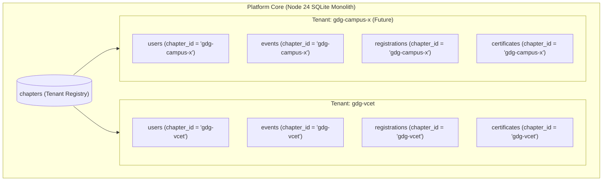

# GDG VCET Platform — Multi-Tenancy Architecture & Scaling Strategy

## 1. Multi-Tenancy Design Overview

The GDG VCET Platform is designed with a **first-class multi-tenant foundation**, while deliberately keeping the initial production deployment focused on its launch tenant:

**Primary Production Tenant:**
- **ID:** `gdg-vcet`
- **Name:** Google Developer Groups on Campus VCET
- **Institution:** Vidyavardhini's College of Engineering and Technology, Vasai
- **Region:** Mumbai Metropolitan Region, India

---

## 2. Tenancy Partitioning Strategy

The platform implements a **Logical Shared-Database / Row-Level Partitioning** architecture:



### 2.1 Table-Level `chapter_id` Partitioning
Every entity table stores an indexed `chapter_id` foreign key referencing `chapters.id`:

| Entity | Partition Column | Default Initial Value | Foreign Key Constraint |
|---|---|---|---|
| `users` | `chapter_id` | `'gdg-vcet'` | `REFERENCES chapters(id)` |
| `events` | `chapter_id` | `'gdg-vcet'` | `REFERENCES chapters(id)` |
| `registrations` | `chapter_id` | `'gdg-vcet'` | `REFERENCES chapters(id)` |
| `speakers` | `chapter_id` | `'gdg-vcet'` | `REFERENCES chapters(id)` |
| `sponsors` | `chapter_id` | `'gdg-vcet'` | `REFERENCES chapters(id)` |
| `agenda_sessions`| `chapter_id` | `'gdg-vcet'` | `REFERENCES chapters(id)` |
| `announcements` | `chapter_id` | `'gdg-vcet'` | `REFERENCES chapters(id)` |
| `certificates` | `chapter_id` | `'gdg-vcet'` | `REFERENCES chapters(id)` |
| `resources` | `chapter_id` | `'gdg-vcet'` | `REFERENCES chapters(id)` |
| `audit_logs` | `chapter_id` | `'gdg-vcet'` | `REFERENCES chapters(id)` |

---

## 3. Data Isolation Guarantees

1. **Query Scoping:**
   Administrative database queries filter by the administrator's active `chapter_id` extracted from their session:
   ```sql
   SELECT * FROM registrations WHERE chapter_id = ? AND event_slug = ?;
   ```
2. **Cross-Tenant Mutation Prevention:**
   Unless the authenticated actor possesses the `super-admin` role, API endpoints restrict write operations to the caller's assigned `chapter_id`.
3. **Public Route Resolution:**
   The public community portal resolves chapter context either from environment configuration (`NEXT_PUBLIC_CHAPTER_ID`) or via incoming host subdomains (`vcet.gdg.community`).

---

## 4. Onboarding a New Campus Chapter

To provision a second campus chapter (e.g. `gdg-spit` or `gdg-dbit`), run:

```sql
-- 1. Insert new chapter profile
INSERT INTO chapters (
  id, slug, name, short_name, tagline, description, institution, primary_color, contact_email
) VALUES (
  'gdg-spit',
  'spit',
  'GDG on Campus SPIT',
  'GDG SPIT',
  'Empowering engineers with Google technologies at SPIT',
  'Sardar Patel Institute of Technology developer community',
  'Sardar Patel Institute of Technology, Andheri',
  '#006E2C',
  'lead@gdgspit.in'
);

-- 2. Create Chapter Lead user account
INSERT INTO users (
  id, chapter_id, name, email, password_hash, role
) VALUES (
  'usr-lead-spit',
  'gdg-spit',
  'Lead Organizer SPIT',
  'lead@gdgspit.in',
  'scrypt$hash...',
  'chapter-admin'
);
```

Once inserted, the chapter lead can immediately log into `/admin/login` using their credentials and manage their isolated events, attendees, and certificates.

---

## 5. Future Tenancy Evolution Path

1. **Subdomain Custom Routing:**
   Configure Next.js middleware to inspect the `Host` header:
   - `vcet.gdgplatform.org` -> sets chapter header to `gdg-vcet`
   - `spit.gdgplatform.org` -> sets chapter header to `gdg-spit`
2. **Dedicated Cloud Storage Buckets:**
   Partition Cloudinary or S3 uploads by chapter slug:
   - `uploads/chapters/gdg-vcet/banners/...`
   - `uploads/chapters/gdg-spit/banners/...`
3. **White-Label Custom Theming:**
   Dynamic CSS token injection based on `chapters.primary_color`, tailoring brand styling per campus.

