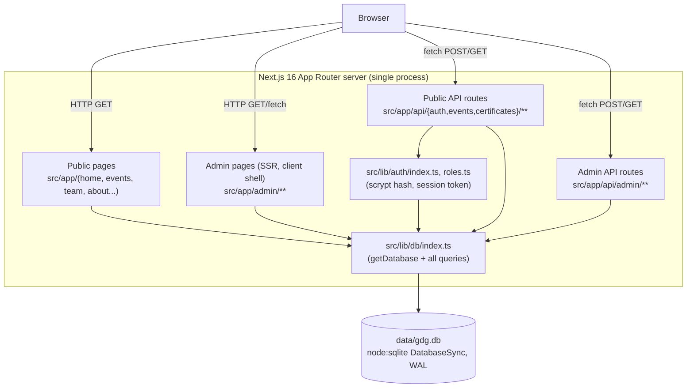
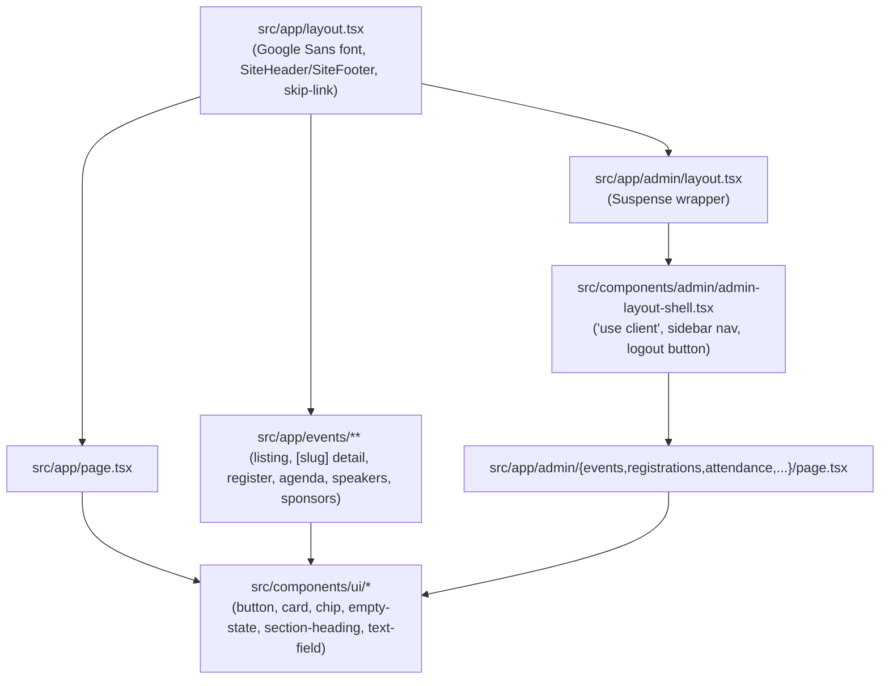
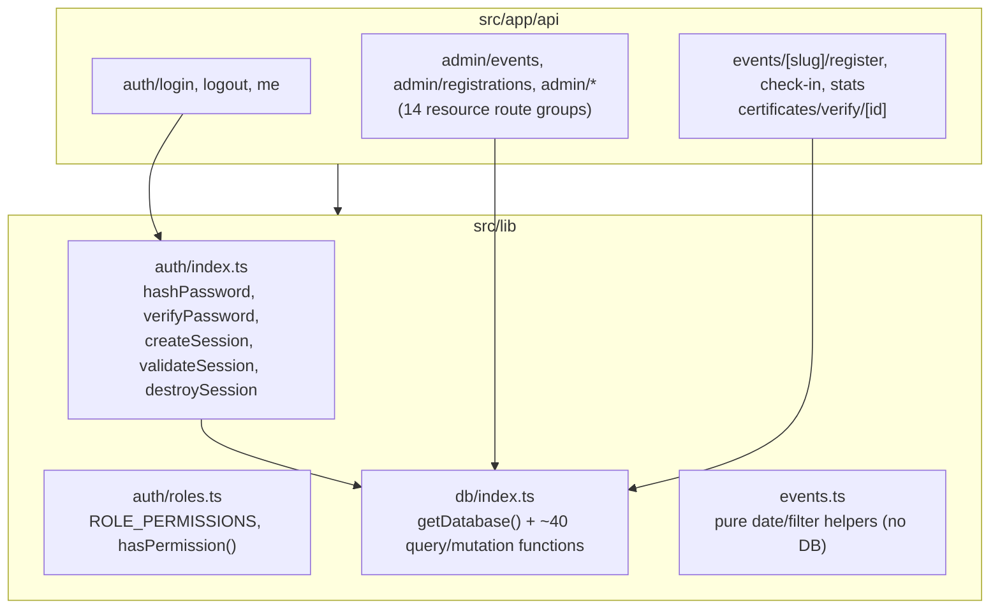
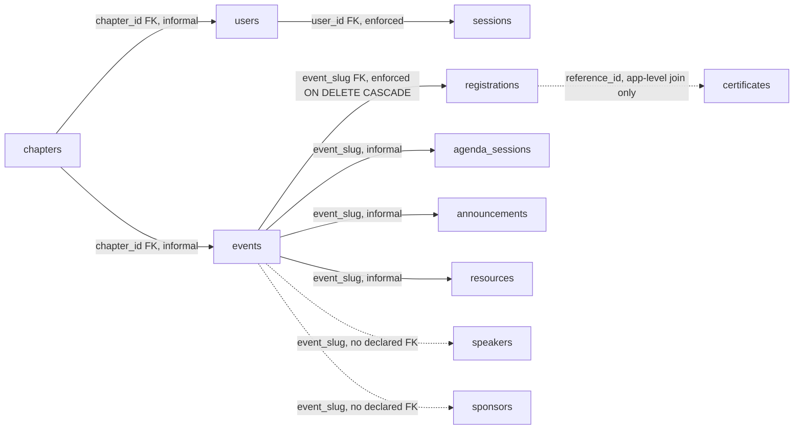
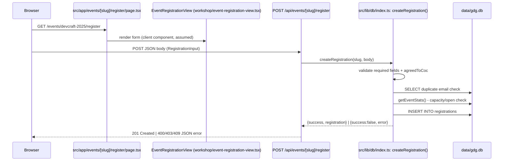
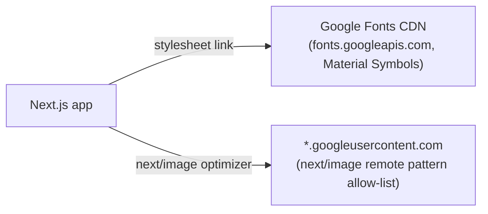

# 02 — System Architecture

All diagrams below are derived from reading the cited source files, not inferred from naming conventions. Where a flow could not be fully confirmed, it is marked UNVERIFIED.

## High-Level System Architecture

Evidence: `src/lib/db/index.ts:44-47` (single lazily-initialized `DatabaseSync` singleton, module-level `_db`), `src/app/admin/page.tsx:2-18` (server component calling `getAllEventsAdmin`/`getPlatformAnalytics` directly — no fetch, no API indirection), `src/app/api/events/[slug]/register/route.ts:2,13` (API route calling `createRegistration` from the same `@/lib/db` module).

## Frontend Architecture

Evidence: `src/app/layout.tsx:1-44` (root layout composition), `src/app/admin/layout.tsx:1-19` (admin sub-tree wraps `AdminLayoutShell` in `Suspense`), `src/components/admin/admin-layout-shell.tsx:1,43-52` (`"use client"` directive; hides the shell only on `pathname === "/admin/login"`, otherwise always renders the nav — see `05`/`10` for the access-control implication).

## Backend Architecture

Evidence: `src/lib/auth/index.ts:1-78` (full module), `src/lib/auth/roles.ts:1-78` (permission table, exported separately and re-exported from `auth/index.ts:4`), `src/lib/events.ts:1-117` (confirmed pure — no imports of `@/lib/db`, matches `CLAUDE.md`'s description of it as unit-tested pure logic).

**Critical observation**: `RolesMod` (`hasPermission`) is defined but a repo-wide search shows it is exported and re-exported (`src/lib/auth/index.ts:4`) yet **not called from any API route** in `src/app/api/admin/**` — none of the 15+ admin route files reference `hasPermission` or `validateSession`. The permission matrix exists in code but is not wired into any request path. See `05-authentication-authorization.md` and `06-admin-panel-audit.md` for the full trace.

## Database Architecture (high level — full ERD in `07-database-audit.md`)

Evidence: `src/lib/db/index.ts:58-259` (full `CREATE TABLE` block). Only two `FOREIGN KEY` constraints are actually declared in SQL: `users.chapter_id → chapters.id` (`:83`) and `sessions.user_id → users.id ON DELETE CASCADE` (`:92`), and `registrations.event_slug → events.slug ON DELETE CASCADE` (`:143`). `speakers`, `sponsors`, `agenda_sessions`, `announcements`, `resources`, `certificates`, `audit_logs` all carry a `chapter_id`/`event_slug` column with **no declared foreign key** — referential integrity there is convention-only. Full detail in `07-database-audit.md` (other fork).

## Main Request Lifecycle — Public Registration (traced end to end)

Evidence: `src/app/api/events/[slug]/register/route.ts:1-47` (full route), `src/lib/db/index.ts:818-935` (`createRegistration` — field validation at `:824-839`, CoC check `:837-839`, duplicate-email check `:843-854`, capacity/open check `:856-864`, reference-ID generation with collision loop `:866-872`, insert `:877-901`, unique-constraint race fallback `:902-911`). The registration **UI component's own validation** was not inspected in this file — the server-side function is authoritative and is the one documented here.

## External Service Integrations

Evidence: `src/app/layout.tsx:26-30` (hard-coded `<link>` to `fonts.googleapis.com` for Material Symbols, with an eslint-disable for `@next/next/no-page-custom-font`), `next.config.ts:4-12` (`images.remotePatterns` allow-listing `*.googleusercontent.com` and `lh3.googleusercontent.com`). **No other external service integration exists in this codebase** — no email, SMS, payment, analytics, or AI/ML SDK was found in `package.json` or any import statement sampled. Any such integration described in other `docs/*.md` files is a plan, not shipped code — UNVERIFIED claims should be checked against `11-devops-deployment.md`.

## Error Handling (observed pattern, not centralized)

Every API route sampled (`src/app/api/events/[slug]/register/route.ts:40-46`, `src/app/api/auth/login/route.ts:61-66`, `src/app/api/auth/me/route.ts:23-27`, `src/app/api/admin/events/route.ts:8-10,32-34`) follows the same manual pattern: a `try { ... } catch (error) { return NextResponse.json({ error, message: String(error) }, { status: 500 }) }`. There is no shared error-handling middleware, no centralized logger, and `src/app/api/auth/login/route.ts:63` leaks `String(error)` (raw exception text) back to the client on the `/api/auth/login` 500 path — see `10-security-audit.md` for severity classification (other fork owns that file; flagged here as an architectural pattern).

## Application Initialization

`getDatabase()` (`src/lib/db/index.ts:44-540`) is the de facto application bootstrap: on first call anywhere in the process, it creates `data/` if missing (`:27-30`), opens/creates the SQLite file, sets `PRAGMA journal_mode = WAL` and `busy_timeout` (`:50-53`), runs the full `CREATE TABLE IF NOT EXISTS` schema (`:56-265`), applies additive `ALTER TABLE` migrations via `safeAddColumn` (`:268-280`, swallowing all errors — `:36-42`), and seeds demo data (one chapter, four admin users with a **shared known password**, one event, 124 synthetic registrations, sample resources/certificates/announcements) (`:282-537`). This runs on every cold start in every environment (dev, build, prod) with no environment guard — it is not gated behind `NODE_ENV !== "production"` anywhere in the function.
